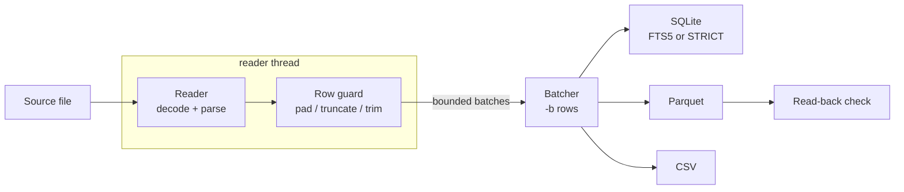

<div align="center">

# DBMorph

**Streaming converter for large, messy data files: CSV, JSON, XLSX, SQL dumps, SQLite and Parquet.**

[](Cargo.toml)
[](https://www.rust-lang.org)
[](https://doc.rust-lang.org/edition-guide/rust-2024/)
[](LICENSE.md)
[](https://www.sqlite.org/fts5.html)
[](https://parquet.apache.org)
<br>
[](https://github.com/DroBov1Tya/DBMorph/commits)
[](https://github.com/DroBov1Tya/DBMorph)
[](https://github.com/DroBov1Tya/DBMorph/stargazers)

[Features](#features) |
[Formats](#supported-formats) |
[Install](#installation) |
[Quick start](#quick-start) |
[Recipes](#recipes) |
[CLI reference](#cli-reference) |
[How it works](#how-it-works) |
[Limitations](#limitations)

</div>

---

DBMorph moves tabular data between files and databases in a single streaming
pass. It is built for the files that break ordinary importers: multi-gigabyte
dumps, unknown encodings, stray quotes, rows with the wrong number of fields.
Instead of failing halfway through, DBMorph repairs what it can, reports what
it could not, and keeps memory usage flat regardless of input size.

```sh
DBMorph -i leak.csv -o leak -f csv -t sqlite -d ';'
```

## Features

- **Streaming end to end.** Rows flow from reader to writer in batches; files
  larger than RAM are fine for CSV, SQL dumps, SQLite and Parquet.
- **Encoding auto-detection.** BOM sniffing plus statistical detection
  ([chardetng](https://crates.io/crates/chardetng)); CP1251, Shift_JIS, UTF-16
  and friends are decoded to UTF-8 on the fly. Override with '-e'.
- **Row repair for dirty CSV.** An unterminated quote is closed at the end of
  its line, so one broken record cannot swallow the rest of the file.
- **Row hygiene.** Short rows are padded, wide rows are truncated, runaway rows
  are dropped. Every fix is counted and reported; '--strict' turns it into a
  hard error.
- **SQL dump parser.** Reads 'CREATE TABLE' and 'INSERT ... VALUES' from
  'mysqldump' or 'pg_dump --inserts' output without a database server.
- **SQLite: full-text search or typed tables.** By default output tables are
  FTS5 virtual tables ('unicode61' tokenizer), ready for 'MATCH' queries.
  With '--sqlite-mode typed' they are 'STRICT' tables with 'INTEGER', 'REAL'
  and 'TEXT' columns inferred from the data, faster to load and smaller on
  disk than FTS5.
- **Parquet done right.** Choice of codec and level, optional type inference
  ('int', 'float', 'bool'), lossless re-compression of existing Parquet files
  and a read-back integrity check after every write.
- **Preview before commit.** The first rows are shown and you confirm before
  anything is written.
- **Script-friendly exit codes.** '0' clean, '2' finished with repaired or
  skipped rows, '1' failed.

## Supported formats

Pick the source with '-f/--from' and the target with '-t/--to'.

| Source ('-f')                | Aliases           | to 'sqlite' | to 'parquet' | to 'csv' |
| ---------------------------- | ----------------- | :---------: | :----------: | :------: |
| CSV / delimited text         | 'csv', 'txt'      |     yes     |     yes      |   yes    |
| SQL dump                     | 'sql', 'dump'     |     yes     |     yes      |   yes    |
| Apache Parquet               | 'parquet'         |     yes     |     yes      |   yes    |
| SQLite database              | 'sqlite'          |      -      |     yes      |   yes    |
| JSON array or NDJSON (beta)  | 'json', 'jsonl', 'ndjson' | yes |     yes      |   yes    |
| Spreadsheet (beta)           | 'xlsx', 'xls', 'ods' |  yes     |     yes      |   yes    |

> [!WARNING]
> JSON and spreadsheet support is in development. It works for typical files,
> but behavior and options may change, and edge cases are not covered yet.

> [!NOTE]
> The output extension is added for you: '-o data' becomes 'data.db',
> 'data.parquet' or 'data.csv' depending on the target.

## Installation

### From source

Requires a Rust toolchain **1.88 or newer** ([rustup](https://rustup.rs)).

```sh
git clone https://github.com/DroBov1Tya/DBMorph.git
cd DBMorph
cargo build --release
./target/release/DBMorph --help
```

### With cargo install

```sh
cargo install --git https://github.com/DroBov1Tya/DBMorph.git
```

The binary is installed as 'DBMorph' into '~/.cargo/bin'.

## Quick start

Run `DBMorph` without arguments to open the interactive terminal UI. It stays
open through setup, optional CSV/TXT diagnostics and safe-fix choice, row
preview and confirmation, live conversion progress, and a completion or error
summary. The setup covers paths, formats, delimiter, table, encoding, batch
size, SQLite typed mode, Parquet type inference, strict mode, replacing a
table, and header handling. Arrow keys select or change fields; Enter edits,
cycles, or confirms; Space toggles options; `s` starts after setup. On the
doctor screen, `a` applies safe fixes and `c` continues without them. Press
`q` or Escape to cancel setup or diagnostics, or to decline the preview.
Conversion currently cannot be cancelled after writing starts: interrupting
a streaming write could leave a partial target. Preview cancellation exits as
cancelled (non-zero); CSV and SQLite destinations are opened only after
preview confirmation.

```sh
# CSV -> SQLite (default source and target)
DBMorph -i users.csv -o users

# CSV -> SQLite STRICT table with INTEGER / REAL / TEXT columns
DBMorph -i users.csv -o users --sqlite-mode typed

# CSV with ';' delimiter -> Parquet with native column types
DBMorph -i sales.csv -o sales -t parquet -d ';' --infer-types

# Parquet -> CSV
DBMorph -i events.parquet -o events -f parquet -t csv
```

DBMorph prints the detected settings, shows a preview of the first rows and
asks for confirmation:

```text
  ? continue? y / n (Enter = yes):
```

> [!TIP]
> For unattended runs (cron, CI, scripts) redirect stdin from '/dev/null'.
> End of input is treated as Enter, so the job proceeds without a prompt:
>
> ```sh
> DBMorph -i users.csv -o users < /dev/null
> ```

## Recipes

<details>
<summary><b>Import a SQL dump into SQLite</b></summary>

```sh
# First table found in the dump
DBMorph -i backup.sql -o backup -f sql

# A specific table; the SQLite table gets the same name
DBMorph -i backup.sql -o backup -f sql -n customers
```

Column names come from 'CREATE TABLE', or from the column list in 'INSERT',
or are generated as 'c0, c1, ...' when neither is present.

</details>

<details>
<summary><b>Search the result with FTS5</b></summary>

```sh
DBMorph -i leak.csv -o leak -n records
sqlite3 leak.db "SELECT * FROM records WHERE records MATCH 'john AND smith' LIMIT 20;"
```

</details>

<details>
<summary><b>Load into SQLite with typed columns</b></summary>

```sh
DBMorph -i sales.csv -o sales -n sales --sqlite-mode typed
sqlite3 sales.db "SELECT region, sum(amount) FROM sales GROUP BY region;"
```

The first 8192 rows are sampled ('--infer-rows' changes that) and each column
gets the narrowest type every non-empty sampled value fits:

| Values in the sample                 | Column type | Stored as                       |
| ------------------------------------ | ----------- | ------------------------------- |
| '42', '-7'                           | 'INTEGER'   | 64-bit integer                  |
| '1.5', '6.02e23', mixed with integers | 'REAL'      | 64-bit float                    |
| 'true' / 'false', any case           | 'INTEGER'   | '1' / '0'                       |
| anything else, or no values at all   | 'TEXT'      | the value as is                 |

- Empty cells in 'INTEGER' and 'REAL' columns become 'NULL'; in 'TEXT'
  columns they stay empty strings.
- Values that would change when read back as numbers stay text: leading zeros
  ('007', zip codes, phone numbers), '+5', '1_000', '.5', 'inf', 'NaN',
  integers too large for 64 bits, and decimals a 64-bit float cannot hold
  exactly (more than 15 significant digits, underflow such as '1e-400').
- Column names that differ only in letter case ('Id', 'id') get a suffix
  ('id_1'), because SQLite treats them as the same column.
- A value further down the file that does not fit its column type is stored
  as 'NULL', counted per column and reported; the exit code is then '2'.
  With '--strict' the run stops at the first such value instead. Values are
  never printed in these messages.

</details>

<details>
<summary><b>Export one table of a SQLite database</b></summary>

```sh
# With a progress percentage (costs one full table scan up front)
DBMorph -i app.db -o orders -f sqlite -t parquet -n orders --count
```

If '-n' names a table that does not exist, DBMorph fails and lists the tables
it found instead of guessing.

</details>

<details>
<summary><b>Re-compress a Parquet file</b></summary>

```sh
DBMorph -i raw.parquet -o packed -f parquet -t parquet -c zstd -l 19
```

Column types, NULLs, nested columns, metadata and row groups are preserved.

> [!WARNING]
> '--trim', '--max-field' and '--infer-types' rewrite cells as text, so with
> any of them the copy no longer keeps the original types and nested columns.

</details>

<details>
<summary><b>Clean up a dirty, headerless dump</b></summary>

```sh
DBMorph -i dump.txt -o clean -f txt -t csv \
  -d '|' -H \
  --columns email,password,source \
  --trim '"'\'' ' \
  --max-field 512
```

- '-H' treats the first line as data
- '--columns' names the output columns (count must match the source)
- '--trim' strips double quotes, single quotes and spaces from both cell edges
- '--max-field' caps every value at 512 characters

</details>

<details>
<summary><b>Handle files with broken quoting</b></summary>

By default a line with an unbalanced quote gets its quote closed at the end
of the line. Two switches change that:

| Flag          | Use when                                                        |
| ------------- | --------------------------------------------------------------- |
| '--no-repair' | The file has valid RFC 4180 multi-line quoted fields to keep    |
| '--no-quote'  | Quotes carry no meaning at all; every line break ends a row     |

</details>

<details>
<summary><b>Force an encoding or a tab delimiter</b></summary>

```sh
DBMorph -i legacy.txt -o legacy -f txt -e windows-1251 -d '\t'
```

'-d' accepts a single character or the escapes '\t', '\n', '\r'.
Encoding names follow the [WHATWG Encoding Standard](https://encoding.spec.whatwg.org/#names-and-labels).

</details>

<details>
<summary><b>Diagnose and repair a damaged CSV or text file</b></summary>

```sh
DBMorph -i dump.csv -o cleaned -t csv --doctor
```

`--doctor` checks up to the first 4 MiB of a CSV/TXT input, reports likely
encoding and row-layout problems, then exits without converting the file. It
selects unambiguous fixes by default and prints a complete conversion command
you can review and run. `--no-auto-fix` leaves every fix for that command to
you. The check is sample-based; it does not prove that the rest of a large file
is clean.

The conversion options below can also be supplied directly:

- `--join-lines` rejoins short rows when consecutive lines add up to the
  header's field count.
- `--realign` restores extra fields only when one text column is an unambiguous
  fit against the other columns' inferred types.
- `--trailing-delimiter` drops an empty final field left by a delimiter at the
  end of a row.
- `--fallback-encoding <ENC>` decodes lines that are invalid UTF-8 with a
  single-byte encoding. The option is used only when the primary encoding is
  UTF-8.
- `--fix-mojibake <ENC>` attempts to reverse text that was UTF-8 decoded as the
  named single-byte encoding.

Rows or values changed by these conversion options are reported and result in
exit code `2`.

</details>

## CLI reference

```text
DBMorph [OPTIONS] --input <FILE> --output <FILE>
```

### Input and output

| Option                     | Default  | Description                                                    |
| -------------------------- | -------- | -------------------------------------------------------------- |
| '-i, --input &lt;FILE&gt;'       |          | Input file path (required)                                     |
| '-o, --output &lt;FILE&gt;'      |          | Output path, extension added automatically (required)          |
| '-f, --from &lt;FORMAT&gt;'      | 'csv'    | 'csv', 'txt', 'json', 'xlsx', 'parquet', 'sqlite', 'sql'       |
| '-t, --to &lt;TARGET&gt;'        | 'sqlite' | 'sqlite', 'parquet', 'csv'                                     |
| '-n, --table-name &lt;NAME&gt;'  | 'main'   | Table to read (SQLite / SQL dump source) or create (SQLite target) |

### Parsing

| Option                 | Default | Description                                                        |
| ---------------------- | ------- | ------------------------------------------------------------------ |
| '-e, --encoding &lt;ENC&gt;' | auto    | Input encoding, detected when omitted                              |
| '-d, --delimiter &lt;CH&gt;' | ','     | Field delimiter for csv/txt; '\t' for tab                          |
| '-H, --no-header'      | off     | First csv/txt row is data; columns become 'c0, c1, ...'            |
| '--no-quote'           | off     | Ignore quotes; every line break ends a row                         |
| '--no-repair'          | off     | Keep RFC multi-line quoted fields instead of closing quotes per line |
| '--columns &lt;A,B,C&gt;'    |         | Override output column names; count must match the source         |
| '--doctor'             | off     | Diagnose a CSV/TXT sample, print a conversion command, then exit   |
| '--no-auto-fix'        | off     | With '--doctor', list safe fixes without selecting them automatically |
| '--join-lines'         | off     | Rejoin short rows when lines add up to the expected field count   |
| '--realign'            | off     | Rejoin extra fields when inferred column types give one clear fit |
| '--trailing-delimiter' | off     | Drop an empty final field caused by a delimiter at row end        |
| '--fallback-encoding &lt;ENC&gt;' |         | Decode invalid UTF-8 lines with this single-byte encoding       |
| '--fix-mojibake &lt;ENC&gt;'      |         | Reverse text misdecoded as this single-byte encoding           |

### Cleaning

| Option              | Default | Description                                               |
| ------------------- | ------- | --------------------------------------------------------- |
| '--trim &lt;CHARS&gt;'    |         | Strip any of these characters from both edges of each cell |
| '--max-field &lt;N&gt;'   | '0'     | Truncate every value to N characters ('0' keeps all)      |
| '-s, --strict'      | off     | Abort on the first malformed row instead of fixing it     |

### Output tuning

| Option                     | Default | Description                                                   |
| -------------------------- | ------- | ------------------------------------------------------------- |
| '-c, --compression &lt;C&gt;'    | 'zstd'  | Parquet codec: 'zstd', 'snappy', 'gzip', 'brotli', 'lz4', 'none' |
| '-l, --level &lt;N&gt;'          | codec   | zstd '1-22', gzip '0-9', brotli '0-11'                        |
| '--infer-types'            | off     | Parquet columns typed as int/float/bool instead of all text   |
| '--sqlite-mode &lt;MODE&gt;'     | 'fts'   | SQLite table layout: 'fts' (FTS5, all text) or 'typed' (STRICT) |
| '--infer-rows &lt;ROWS&gt;'      | '8192'  | Rows sampled for '--infer-types' and '--sqlite-mode typed'    |
| '-b, --batch-size &lt;ROWS&gt;'  | '50000' | Rows buffered per write or insert batch                       |
| '-x, --drop-existing'      | off     | Drop the target SQLite table before inserting                 |
| '--count'                  | off     | Count source rows first for a progress percentage (SQLite source) |

### Exit codes

| Code | Meaning                                                         |
| :--: | --------------------------------------------------------------- |
| '0'  | Command completed; '--doctor' exits successfully after its check |
| '1'  | Error, nothing or only part of the data was written             |
| '2'  | Success, but some rows were repaired, realigned or dropped      |

## How it works



1. **Read.** Each reader yields rows lazily. CSV goes through a 1 MiB buffer
   and the quote-repair adapter; JSON arrays are split by a byte scanner
   instead of being parsed whole; SQL dumps are tokenized in one pass.
2. **Guard.** Every row is checked against the expected column count. Short
   rows are padded with empty values, long rows are cut, runaway rows (more
   than 16x the expected width, at least 4096 fields) are dropped. The first
   10 problems are printed, the rest are counted. Reading, decoding and the
   guard run on their own thread and hand rows to the writer in batches of
   4096 rows or 8 MiB of text, whichever comes first (at most 4 batches in
   flight), so parsing overlaps with writing.
3. **Write.** Rows are batched and written:
   - **SQLite** uses multi-row 'INSERT' statements split under the bound
     parameter limit, inside one exclusive connection with journaling off.
     The table is created after the preview is confirmed; in typed mode its
     column types are inferred from the sampled rows, and every cell is bound
     as an integer, float or text value. A new FTS5 table is loaded with
     segment merging deferred, then optimized into a single segment and its
     FTS5 settings restored, also when the load fails.
   - **Parquet** builds Arrow record batches; with '--infer-types' the column
     types are inferred from the first 8192 rows ('--infer-rows').
   - **CSV** is written as UTF-8 through a buffered writer.
4. **Verify.** Parquet output is reopened and the first, a middle and the last
   rows are read back.

Progress shows a percentage, rows per second and an ETA. For CSV, SQL dump
and JSON sources it follows the bytes read from the file; for Parquet and a
counted SQLite table ('--count') it follows rows.

## Limitations

- **SQLite target is tuned for bulk loading.** 'journal_mode=OFF' and
  'synchronous=OFF' make inserts fast, but if the run is interrupted (Ctrl+C,
  crash, power loss) the output '.db' file can be left corrupted. The input
  file is only read and is never at risk. Because the output file may already
  hold other tables, write to a fresh file, not to a database you care about.
- **FTS5 columns are text.** FTS5 tables have no column types, so the
  default mode moves values exactly as they are. Use '--sqlite-mode typed'
  for numeric columns, or convert after import, see
  [typed columns after import](#typed-columns-after-import).
- **Typed mode infers types from a sample.** Rows after the sample are not
  seen until they are inserted, so a late non-numeric value in a numeric
  column becomes 'NULL' (reported, exit code '2'). Raise '--infer-rows' for
  data that changes shape deep into the file; the sample is held in memory.
  There are no date or time types: such values are stored as 'TEXT'.
  'REAL' is a 64-bit float: '12.30' is stored as '12.3', and a column with
  longer decimals stays 'TEXT' rather than being rounded.
- **JSON and spreadsheets are in development (beta).** Spreadsheets are read
  from the first sheet only, and the sheet is loaded into memory. JSON is read
  twice: the first pass collects the union of keys to build the schema; nested
  objects and arrays are stored as compact JSON strings.
- **SQL dumps** are read for one table per run; pick it with '-n'.
  PostgreSQL 'COPY ... FROM stdin' blocks are not parsed, dump with
  'pg_dump --inserts' instead.
- **SQLite to SQLite** is not supported yet.

### Typed columns after import

'--sqlite-mode typed' covers most cases at conversion time. To keep both
full-text search and typed columns, copy the FTS5 table into a regular table
with the types you need:

```sql
CREATE TABLE users_typed (
    id      INTEGER,
    email   TEXT,
    balance REAL
);

INSERT INTO users_typed (id, email, balance)
SELECT CAST(id AS INTEGER), email, CAST(balance AS REAL)
FROM users;
```

For Parquet output the same is done at conversion time with '--infer-types'.
Both use the same inference rules described in
[typed columns](#recipes).

## Roadmap

- [ ] PostgreSQL target
- [ ] MySQL target
- [ ] ClickHouse target

## Contributing

Issues and pull requests are welcome. Before opening a PR:

```sh
cargo fmt --all
cargo clippy --all-targets -- -D warnings
cargo test
```

## License

Distributed under the MIT License. See [LICENSE.md](LICENSE.md) for details.
